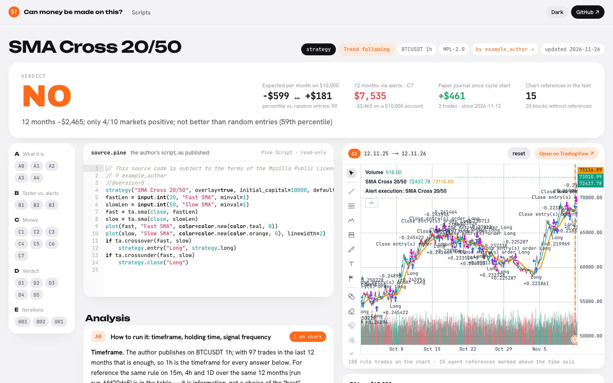

# 🌲 pine2profit

> Can money be made on this? A dashboard for an agent that loops over TradingView Pine Script indicators and strategies and answers that one question per script by trading its alerts on paper. The package is the static site plus a local server that serves your `data/` folder to it — the same files go to GitHub Pages unchanged.



[](https://npmjs.org/package/pine2profit)
[]()
[]()

🐙 **[GitHub](https://github.com/pine2profit/pine2profit)** · 📖 **`npx pine2profit --help`** prints the data contract with JSON examples

---

## 🚀 Quick Start

```bash
npx pine2profit <dir>            # dir = the folder that contains data/
```

Open http://localhost:60050. The site reads everything with plain `GET` from `data/`, so a data folder that works here works on GitHub Pages unchanged.

## Filling the site with an agent

The package does not write `data/`. It is built so that an AI agent running in a loop can: the contract is a few flat files, and the server picks up every change on the next request (`Cache-Control: no-store`). A typical setup with Claude Code:

1. **Start the preview** in the project folder and leave it running:

   ```bash
   mkdir -p project/data && npx pine2profit ./project
   ```

   An empty `index_1.jsonl` is a valid start. The folder is checked on every start and a single error refuses to start, so the agent never looks at a page that silently shows something wrong.

2. **Give the agent the contract.** `npx pine2profit --help` prints it with JSON examples; paste the output into the agent's system prompt or `CLAUDE.md`, together with the question it has to answer for every script and the rule for writing the report. The agent needs to know four things:

   - every script is an `id` (`[a-z0-9-]+`) and up to three files `data/<id>_messages.json`, `data/<id>_candles.json`, `data/<id>_pinescript.json`;
   - one line per script is appended to the last `data/index_N.jsonl`; a later line with the same `id` replaces the earlier one, so an update is an append, never a rewrite;
   - the report is markdown in `messages`; every claim about the chart carries a reference (`[[t:…]]`, `[[range:…]]`, `[[trade:N]]`) so the reader can click and see the bars;
   - `head` in `_messages.json` repeats the index line.

3. **Run the loop.** Each iteration: pick a script, run the backtest / paper check, write or update the three files, append the index line. The agent can open http://localhost:60050/run/?id=<id> itself (or screenshot it) to check that the page renders what it wrote. Nothing has to be restarted.

4. **Publish.** Commit `data/` next to the site build and push: GitHub Pages serves the same relative paths as the local server, so what the agent checked locally is what goes live.

For a long-running loop keep `index_N.jsonl` chunks around 1000 lines and start `index_{N+1}` when the last one is full; the site reads them in order and stops at the first missing file.

## CLI

```bash
npx pine2profit .
npx pine2profit ./project --port 8080
npx pine2profit /var/agent/project --host 127.0.0.1 --port 60050
npx pine2profit --help                 # the data contract with JSON examples
```

| flag | default | |
|---|---|---|
| `--port <number>` | `CC_WWWROOT_PORT` or `60050` | HTTP port |
| `--host <string>` | `CC_WWWROOT_HOST` or `0.0.0.0` | bind address |
| `--help`, `--version` | | |

The server answers two things and nothing else — no API, no POST:

- `GET /` — the dashboard
- `GET /data/<file>` — `<dir>/data/<file>` as is, `Cache-Control: no-store`, 404 when the file is missing

### Startup check

Before listening, `<dir>/data` is validated against the contract below. A single error refuses to start with exit code 1 and the list of problems (`file:line` for the index, `file  path` inside JSON documents, at most 50 shown); warnings are printed and the server starts anyway.

| checked | error |
|---|---|
| `data/` exists, `index_1.jsonl` exists (an empty file is fine), index files are numbered without gaps | |
| every index line is JSON with the fields below | required field missing, wrong type or value, unknown field (a typo such as `tv_url` is reported with the right name) |
| every script in the index has `<id>_messages.json` and `<id>_candles.json` | missing file, invalid JSON |
| `<id>_messages.json` | `head` differs from the index line, bad `groups` or `messages` shape, a chart reference that points at nothing (`[[trade:99]]` without that trade, a range that ends before it starts, a date that does not parse) |
| `<id>_candles.json` | empty or non-numeric `bars`, time not growing, `high` below `low`, duplicate trade ids |
| `<id>_pinescript.json` (optional) | invalid JSON, `source` missing |
| warnings only | files for ids that are not in the index, files the site never reads, a missing `head` |

## The data folder

Everything lives flat in `<dir>/data/`, no subfolders. `<id>` is a slug matching `[a-z0-9-]+` and prefixes every file of that script.

```
data/
  index_1.jsonl                     the list, ~1000 lines per file; index_2.jsonl, … continue it
  sma-cross-20-50_messages.json     the report text for one script
  sma-cross-20-50_candles.json      bars, trades and equity for the chart
  sma-cross-20-50_pinescript.json   the author's script and the trade rule (optional)
```

Dollars are integers on a notional $10,000 account. Leave a field out when it is null.

### `index_N.jsonl` — the list

One JSON object per line, one script per object. The site reads `index_1`, then `index_2`, … and stops at the first 404. **A later line with the same `id` replaces the earlier one**, so append updates to the last file instead of rewriting old ones.

Required: `id`, `title`, `kind`, `verdict`, `updated`.

```json
{"id":"sma-cross-20-50","title":"SMA Cross 20/50","kind":"strategy","subcategory":"trend-following","verdict":"NO","main":-2465,"paper":461,"paperTrades":3,"expected":[-599,181],"iterations":3,"updated":"2026-11-26","market":"BTCUSDT","timeframe":"1h","license":"MPL-2.0","author":"example_author","tvUrl":"https://www.tradingview.com/script/EXAMPLE02/","cycleStart":"2026-11-12","percentile":59,"reason":"12 months −$2,465; only 4/10 markets positive; not better than random entries (59th percentile)"}
```

| field | type | meaning |
|---|---|---|
| `id` | string | slug, prefix of the script's other files |
| `title` | string | |
| `kind` | `indicator` \| `strategy` | |
| `subcategory` | string | any key — the list builds its filter chips from the values it sees. Keys with a label on the site: indicators `trend oscillator volatility volume structure signals`; strategies `trend-following mean-reversion breakout grid-dca pattern-event composite` |
| `usable` | boolean | `false` = no signal is final at bar close. The page says "not tradeable" and shows no rule and no money numbers |
| `verdict` | `YES` \| `NO` \| `UNKNOWN` | |
| `main` | number | 12 months via alerts, $ |
| `paper`, `paperTrades` | number | paper journal since `cycleStart`: $ and trade count |
| `expected` | `[low, high]` | expected per month on $10,000 |
| `iterations` | number | default 1 |
| `updated` | `YYYY-MM-DD` | |
| `market`, `timeframe`, `license`, `author`, `tvUrl` | string | header chips and the author link |
| `cycleStart` | `YYYY-MM-DD` | drawn on the chart and on the P&L line |
| `percentile` | number | the rule's percentile against random entries |
| `reason` | string | one sentence under the verdict |

A script that is not tradeable:

```json
{"id":"volume-pressure","title":"Volume Pressure Delta","kind":"indicator","subcategory":"volume","usable":false,"verdict":"NO","iterations":1,"updated":"2026-11-26","market":"BTCUSDT","timeframe":"1h","reason":"not tradeable: the signal depends on realtime tick data (varip)"}
```

### `<id>_messages.json` — the report text

```json
{
  "head": { "id": "sma-cross-20-50", "title": "SMA Cross 20/50", "kind": "strategy", "verdict": "NO", "updated": "2026-11-26", "…": "the same fields as the index line" },
  "groups": [
    { "code": "A", "title": "What it is" },
    { "code": "C", "title": "Money" },
    { "code": "E", "title": "Iterations" }
  ],
  "messages": [
    { "code": "A0", "title": "How to run it", "md": "Run it on **1h**. A typical trade: [[trade:137]]." },
    { "code": "C2", "title": "The last 12 months", "md": "Window [[range:2025-11-12T00:00Z..2026-11-12T00:00Z]]: 97 trades, -$2,465." },
    { "code": "E1", "title": "What happened since the previous iteration?", "md": "Three paper trades, +$461.", "iteration": 3, "date": "2026-11-26" },
    { "code": "E1", "title": "What happened since the previous iteration?", "md": "First week on paper.", "iteration": 2, "date": "2026-11-19" }
  ]
}
```

- **`head`** repeats the index line with the same values, so a direct link to `/run/?id=<id>` renders the header without scanning the index.
- **`groups`** is the left navigation, in this order.
- **`messages`** render in file order; nothing is deduplicated — put in the file what the page should show.

| message field | |
|---|---|
| `code` | optional; `A0`, `C7`, `E1`, `RISK2` — shown on the block and in the navigation |
| `group` | optional; default: the leading letters of `code` (`A0` → `A`, `RISK2` → `RISK`) |
| `title` | |
| `md` | markdown |
| `iteration` | optional; consecutive messages with the same value form a dated section. Messages without it go under "Analysis" |
| `date` | optional; shown next to the section title |

A group that appears in messages but not in `groups` is shown with its code as the title; a group without messages is dropped. Inside a group the navigation items are the message codes, or the iteration numbers when every message of the group carries `iteration`. The site knows nothing about the letters — any codes and titles work.

**Chart references** inside `md` become buttons that frame the chart:

```
[[t:2026-11-12T14:00Z]]                                a bar
[[t:2026-11-12T14:00Z@41820]]                          a bar and a price
[[range:2026-11-01T00:00Z..2026-11-08T00:00Z]]         a segment, both edges marked
[[trade:12]]                                           a trade from <id>_candles.json
[see the breakout](ref:range:2026-11-01T00:00Z..2026-11-08T00:00Z)   the same, as a link
```

### `<id>_candles.json` — the chart

```json
{
  "timeframe": "1h",
  "bars": [
    { "time": 1732665600000, "open": 62000, "high": 62000, "low": 61498.5, "close": 61498.5, "volume": 377 },
    { "time": 1732669200000, "open": 61498.5, "high": 61553.9, "low": 61201.0, "close": 61340.2, "volume": 412 }
  ],
  "trades": [
    { "id": 1, "side": "long", "open_time": 1732928400000, "open_price": 61642.5, "close_time": 1732996800000, "close_price": 60510.8, "pnl_usd": -195.58 }
  ],
  "equity": [
    { "time": 1732665600000, "backtest_usd": 0, "paper_usd": null },
    { "time": 1732996800000, "backtest_usd": -195.58, "paper_usd": null }
  ]
}
```

| key | |
|---|---|
| `timeframe` | optional; falls back to the index line |
| `bars` | feed the chart; `time` in ms |
| `trades` | optional; label and frame `[[trade:N]]`. `close_time` / `close_price` are `null` while open |
| `equity` | optional; draws the P&L line — no line without it |

No file at all: the page says "no candles for this script" and the text still renders.

### `<id>_pinescript.json` — optional

```json
{
  "source": "//@version=5\nindicator(\"EMA Ribbon\", overlay=true)\nplot(ta.ema(close, 20))\nplot(ta.ema(close, 50))",
  "rule": "//@version=5\nstrategy(\"EMA Ribbon rule\", overlay=true, initial_capital=10000)\nif ta.crossover(ta.ema(close, 20), ta.ema(close, 50))\n    strategy.entry(\"Long\", strategy.long)\nif ta.crossunder(ta.ema(close, 20), ta.ema(close, 50))\n    strategy.close(\"Long\")"
}
```

`source` is the author's script: shown read-only and run on the chart. `rule` is the trade rule as a Pine `strategy()`; its fills become the trade markers. No file → no code panel. No `rule` → the chart runs the author's script only.

### A minimal data folder

```
<dir>/data/index_1.jsonl
<dir>/data/sma-cross-20-50_messages.json
<dir>/data/sma-cross-20-50_candles.json
<dir>/data/sma-cross-20-50_pinescript.json
```

## Using the server from code

```ts
import { serve, validate, setLogger, setConfig } from "pine2profit";

for await (const issue of validate("/path/to/project")) {    // yields { level, file, line?, at?, message } as problems are found;
  console.log(issue);                                         // the folder is read one file at a time, whatever its size
}
const dispose = serve("0.0.0.0", 60050, "/path/to/project");  // serves /path/to/project/data; serve() itself does not validate
```

The third argument wins over `CC_DATA_PATH`, which wins over `process.cwd()`.

| variable | default | |
|---|---|---|
| `CC_WWWROOT_HOST` | `0.0.0.0` | bind address |
| `CC_WWWROOT_PORT` | `60050` | port |
| `CC_DATA_PATH` | `process.cwd()` | folder that contains `data/` for `serve()` called without a path; the CLI always takes `<dir>` from the command line |
| `CC_WWWROOT_PATH` | bundled build | override of the static root |
